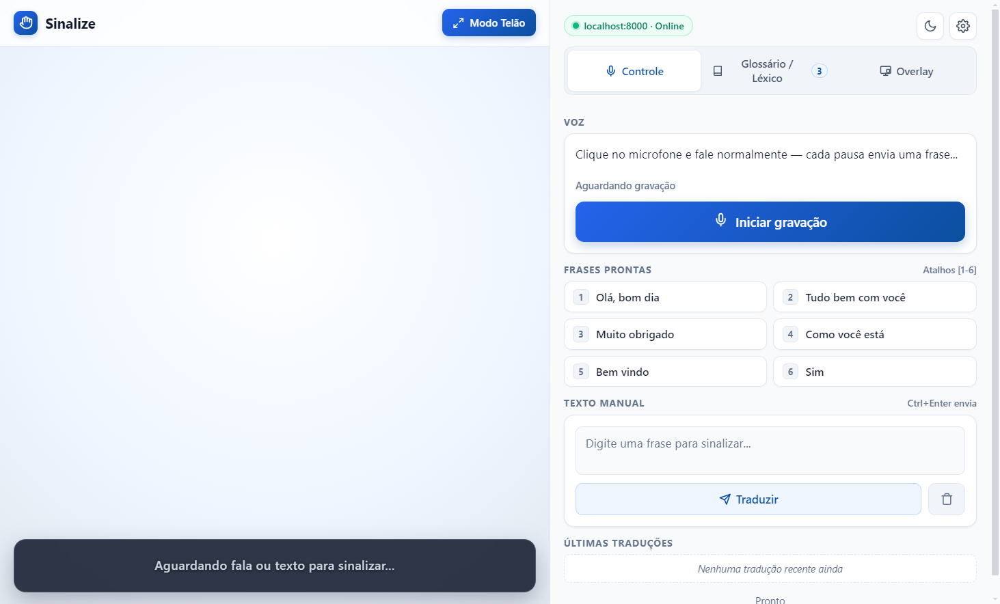
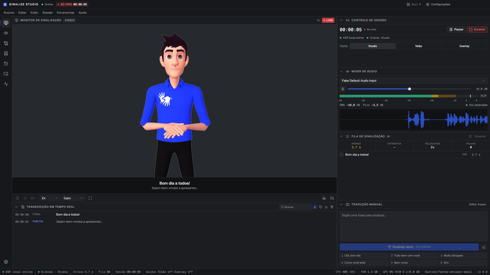

# Sinalize Studio 2.0 — arquitetura e decisões

Estação de operação de acessibilidade em tempo real: fala em português → transcrição → glossário →
legenda + fila de sinalização → avatar VLibras no monitor do Studio, no Telão ou no Overlay.

## Antes e depois

| v1 (HTML/CSS/JS, `main`) | v2 (este branch) |
|---|---|
|  |  |

Capturas reais em `docs/screenshots/`, geradas pelos testes E2E (`npm run e2e`) sobre o app compilado:
`studio-<largura>x<altura>-<tema>.png` (1024×768, 1366×768, 1920×1080, 2560×1440; escuro e claro),
`sessao-ao-vivo.png`, `studio-sinalizando.png`, `telao.png`, `overlay-*.png`, `modulo-*.png`,
`config-*.png`, `paleta-comandos.png`, `workspace-compacto.png`.

## Stack

| Camada | Tecnologia |
|---|---|
| Desktop | Electron 34, electron-vite 6 (Vite 8) |
| Interface | React 19, TypeScript strict, Tailwind CSS 4, shadcn/ui (Radix UI), Lucide |
| Estado | Zustand (stores por funcionalidade, `zustand/vanilla` + `persist`) |
| Workspace | React Resizable Panels 4 (grupos aninhados, persistência por grupo) |
| Listas longas | TanStack Virtual (console de transcrição) |
| Validação | Zod (mensagens IPC e preferências persistidas) |
| Interação | cmdk (paleta de comandos), Sonner (avisos), Motion (transições da legenda) |
| Áudio | Web Audio API (grafo próprio) e Canvas (medidor e forma de onda) |
| Tipografia | Geist, Geist Mono e Inter embarcadas (`@fontsource-variable`, funcionam offline) |
| Testes | Vitest (unitários), Playwright + axe-core (E2E e acessibilidade no Electron) |

## Estrutura

```text
src/
├── main/
│   ├── index.ts                   # bootstrap: sessão, permissões, protocolo app://, IPC do app
│   ├── pages.ts                   # URLs das páginas (dev server × app://) e origem do app
│   ├── windows/
│   │   ├── studio.window.ts       # janela sem moldura nativa + botões do Windows sobrepostos
│   │   └── presentation.window.ts # Telão (tela cheia no secundário; em janela com um monitor só)
│   └── services/
│       ├── output-manager.ts      # Telão + Overlay, motor único do Unity, atalhos globais, monitores
│       ├── output-settings.ts     # padrões, presets e validação das configurações de saída
│       ├── display.ts             # geometria multi-monitor
│       ├── diagnostics.ts         # telemetria via IPC, exportação JSON/CSV
│       ├── system-metrics.ts      # CPU, RAM, GPU/VRAM (nvidia-smi) a cada 2 s
│       └── telemetry.ts           # métricas por segmento (P50/P95/P99)
├── preload/index.ts               # window.sinalize (contextBridge)
├── shared/
│   ├── ipc.ts                     # canais e tipo da API exposta
│   ├── output.ts                  # contratos das saídas, comandos e eventos
│   └── schemas.ts                 # schemas Zod das mensagens IPC
└── renderer/
    ├── studio.html · presentation.html · avatar-overlay.html · caption-overlay.html
    ├── public/vlibras-stage.html  # player Unity do VLibras sem o widget (transparente)
    └── src/
        ├── apps/                  # entradas React: studio, presentation, avatar-overlay, caption-overlay
        ├── components/
        │   ├── layout/            # TitleBar, MenuBar, Sidebar, StatusBar
        │   ├── workspace/         # Dock, DockPanel (recolhível), ResizeHandle, ModuleFrame
        │   └── ui/                # shadcn/ui reestilizado (densidade e tokens do Studio)
        ├── features/
        │   ├── session/           # sessão, gravador (VAD + Whisper), STT, estados dos serviços
        │   ├── audio/             # mixer, medidor dBFS em canvas, calibração do VAD
        │   ├── transcription/     # proteção contra loop, histórico com revisões, console virtualizado
        │   ├── translation/       # fila de sinalização, tradução manual, frases rápidas
        │   ├── avatar/            # player (motor único) e monitor de sinalização
        │   ├── captions/          # legenda do monitor e modelo das legendas de saída
        │   ├── glossary/ history/ diagnostics/ output/ settings/ command/ workspace/ appearance/
        └── styles/globals.css     # tokens semânticos (escuro e claro)
```

## Decisões

**Lógica fora do React.** Gravador, fila, legenda e transcrição são classes/stores TypeScript
(`zustand/vanilla`) assinadas pelos componentes. Timers de 50 ms (VAD, fila) e o medidor a 60 fps
não disparam renderização do workspace; o medidor desenha direto no canvas a partir do `AnalyserNode`.

**Uma única instância do Unity.** O avatar roda em uma saída por vez, com prioridade
Telão > Overlay > Studio. Ao trocar, a frase em sinalização volta para a frente da fila
(`requeue` na telemetria) e o monitor do Studio mostra qual saída está ativa. Duplicar o Unity
só para manter prévia dobraria CPU/GPU (~1 núcleo por instância visível).

**Monitor nunca é desmontado.** A sidebar troca apenas o lado direito do workspace (docks ou o
módulo escolhido); o player continua visível ao lado de qualquer módulo e a captura segue ativa.

**Workspace estável em vez de docking livre.** Grupos redimensionáveis aninhados, docks recolhíveis
até o cabeçalho, visibilidade pelo menu Exibir, seis presets (Padrão, Operação ao vivo,
Monitoramento de áudio, Transcrição, Diagnóstico, Compacto) e tamanhos persistidos por grupo.
Arrastar docks entre colunas foi deixado de fora: complexidade alta para pouco ganho operacional.

**Tokens de texto × preenchimento.** O azul de acento e o vermelho têm variantes para texto
(`--brand-fg`, `--danger`) e para fundos com texto branco (`--accent-base`, `--danger-strong`):
o axe-core apontou contraste insuficiente quando a mesma cor servia aos dois usos.

**Segurança preservada.** Todas as janelas com `contextIsolation`, `sandbox` e `nodeIntegration: false`;
o Studio roda com `webSecurity`. Microfone liberado só para as páginas do app; CORS do servidor local
só para a origem do app; nenhum cabeçalho de segurança é removido; mensagens IPC validadas com Zod.

**Preferências preservadas.** Chaves do `localStorage` da v1 (provedor STT, chave da OpenAI, glossário)
continuam valendo; `overlay.json` é lido como fallback de `output.json`.

## Atalhos

| Atalho | Ação | Escopo |
|---|---|---|
| Ctrl+K | Paleta de comandos | Studio |
| Ctrl+, | Configurações | Studio |
| Ctrl+Shift+Enter | Iniciar/encerrar sessão | Studio |
| Ctrl+Shift+P | Pausar/retomar captura | Studio |
| Ctrl+Shift+D | Diagnóstico | Studio |
| Ctrl+Enter | Sinalizar texto digitado | Tradução manual |
| 1–9 | Frases rápidas | Studio (fora de campos) |
| F11 | Monitor em tela cheia | Studio |
| Ctrl+Alt+Shift+O/E/A/L/R/M | Overlay, edição, avatar, legendas, posições, sessão | Global (configurável) |

## Testes

- `npm run check`: typecheck (main, renderer, E2E), ESLint, Vitest e build.
- `npm run e2e`: compila e roda o Playwright contra o app real com perfil isolado
  (`SINALIZE_USER_DATA`), sem tocar nas preferências do usuário. A sessão ao vivo usa
  `e2e/fixtures/fala-ptbr.wav` como microfone (`--use-file-for-fake-audio-capture`) e o servidor
  local de transcrição; o teste é pulado se `localhost:8000` não responder.
